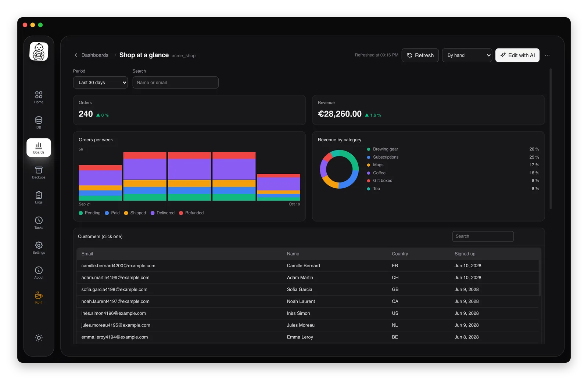

# Dashboards

Describe what you want to follow in a database and the AI builds a dashboard for it: key figures, charts, tables, filters. bbdump keeps it, reads the data again each time you open or refresh it, and lets you change it whenever you like, with the AI or by hand. The AI only reads.

## Creating a dashboard

Open **Dashboards** in the sidebar and click **New dashboard** (or **New dashboard** in the ⋯ menu of a database card). Choose the database, a name, and either:

- a template under **Start from**: **Overview**, **Activity over time**, **Search and details**, **Track a figure**, **Rankings**, **Data quality**. A template only fills in the request; you can change it before creating;
- or your own words in **What do you want to see?** ("orders per day over the last 30 days, revenue by city, latest orders…").

**Create** opens the dashboard with its editor. The AI reads the schema, tries each query before using it (bbdump's `check_query` tool, which looks at the result's shape, not its values), then writes the blocks. Each step can be unfolded, as in the [database chat](database-chat.md). When it is done, it suggests a few next steps you can click.

The AI tool is the one chosen in the **AI settings** of the chat: Claude Code, Codex, OpenCode, or a local model with Ollama or LM Studio.

## Changing it with the AI

**Edit with AI** opens the editor next to the dashboard. Ask for a change ("add a chart of new rows per week", "a period filter at the top"): the AI changes only what you asked, and **Dashboard updated** shows when it is applied. A change that cannot be used leaves the dashboard as it was.

- **✦** on a block asks for a change to that block only.
- **?** on a block (**Explain this figure**) asks the AI to explain it in plain words: where the figures come from, what is counted, over which period. The dashboard does not change.
- When some blocks fail to load, **Fix with AI** sends their errors to the AI.
- ⋯ → **Undo the last AI change** brings back the previous version; **New conversation with the AI** starts the editor afresh.

## Filters, search and linked blocks

A dashboard can have filters at the top, used by every block that asks for them:

- **Period**: last 7, 30 or 90 days, last 12 months, this year, all time, or custom dates. Key figures are compared with the period before;
- **search** fields (a name, an email…) and **lists** of values.

Clicking a bar, a donut slice or a table row filters the dashboard on it; click again to clear. That is how a search-and-details dashboard works: search a customer, click them, and the record and their latest orders follow.

Filters are kept with the dashboard. In queries they are bound values (`{{from}}`, `{{to}}`, `{{name}}`), never pasted into the SQL.

## Refreshing

**Refresh** reads every block again. The list next to it refreshes on its own: **By hand**, every minute, 5 minutes, 15 minutes or hour. A slow query is flagged on its block, since it runs on every refresh.

⋯ → **Keep the last results** stores the results (encrypted) so the dashboard opens at once, then refreshes.

## Arranging it by hand

- **Move:** drag a block by its grip (or use the arrow keys on the grip), or **Move up** / **Move down** in its menu.
- **Resize:** drag its bottom-right corner. The width snaps to twelfths of the dashboard; the height is free. A double-click on the corner gives back the automatic size. **Width** in the menu does the same.
- **Block menu (⋯):** **Rename**, **Edit the SQL** (with **Try** before saving), **Show as** (bars, line, area, donut, table…), **Split the figures into cards**, **Duplicate**, **Hide**, **Delete the block**, and its exports.
- ⋯ → **Appearance**: colours and density.

On a narrow window, blocks go full width.

## Exporting and sharing

From the dashboard's ⋯ menu:

- **Export as PDF**: the dashboard on A4 landscape, tables with all the rows of their page;
- **Export to Excel (every block)**: one sheet per block, numbers and dates usable as such;
- **Export the dashboard file**: the dashboard itself (blocks, queries, layout, filters), without data. **Import** on the Dashboards page opens it on a database of your choice;
- **Use on another database**: a copy on another database with the same tables, a local copy of production for instance;
- **Pin to the home page**: a shortcut on the home page.

Each block also has **Export as CSV**, **Export to Excel** and **Copy for a spreadsheet** (paste into Excel or Google Sheets).

## Read only

Every query is a `SELECT` run in a read-only transaction by bbdump; nothing is ever written to the database. The AI gets the database's reading tools only, as in the [database chat](database-chat.md#read-only-limited-to-this-database), and columns [anonymized for AI](mcp-server.md#personal-data-anonymized-for-ai) stay anonymized for it. The blocks themselves show your real data, on your computer.

## Where they are kept

Dashboards are saved per database, encrypted, in `dashboards/<database id>/` in the [data folder](configuration.md#data-folder), with their conversation with the AI. ⋯ → **Delete the dashboard** removes one; removing a database from bbdump removes its dashboards.
